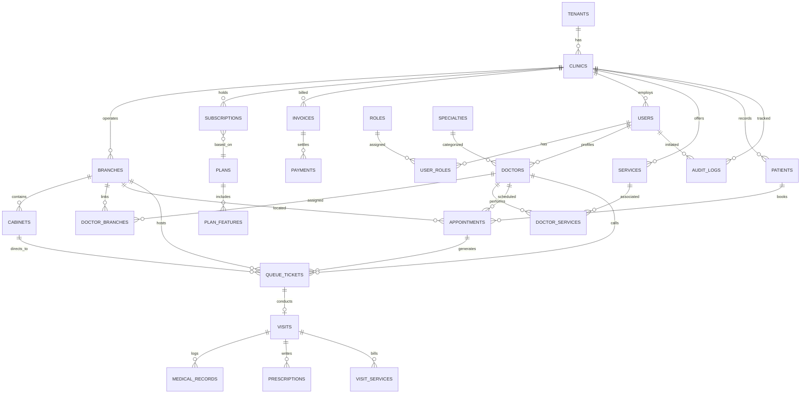
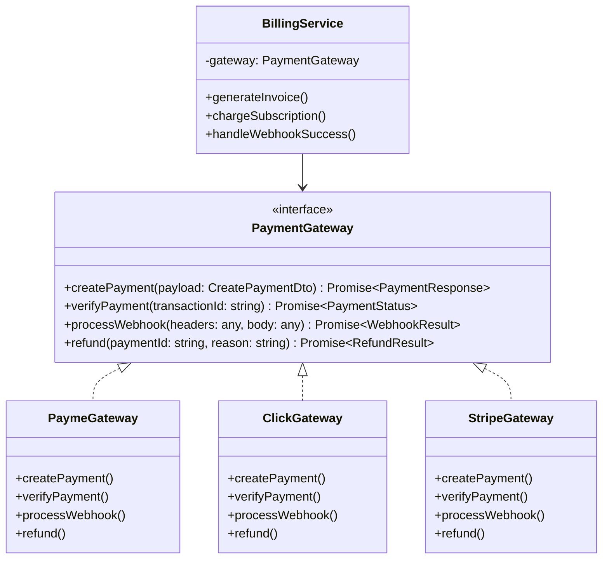
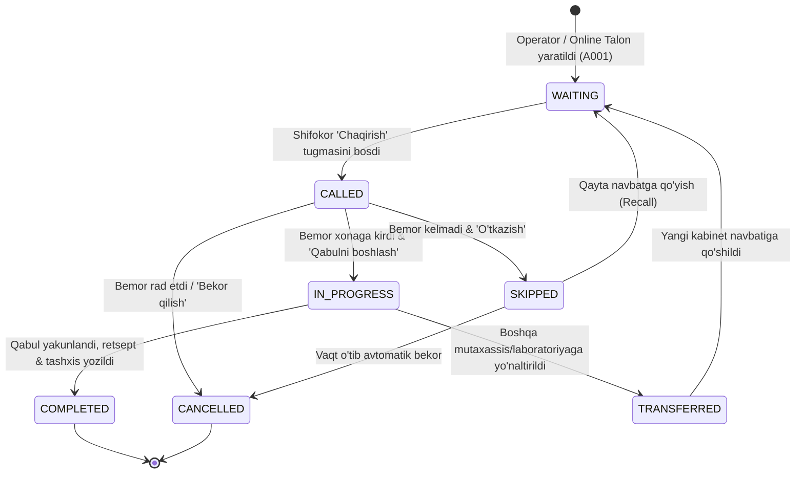

# SADAF CLINIC MANAGEMENT PLATFORM
## Multi-Tenant SaaS Architecture Blueprint & Technical Specifications

---

## 1. System Architecture Diagram

```mermaid
flowchart TB
    subgraph ClientLayer [Client & Edge Layer]
        SA_UI["Super Admin Web Panel\n(React/Vite + Tailwind/Custom CSS)"]
        UP_UI["Clinic User Panel\n(Owner, Manager, Doctor, Operator, Reception)"]
        TV_UI["TV Display Fullscreen Engine\n(WebSocket Driven, Token-Paired)"]
        MOB_UI["Mobile App (Flutter / Future)"]
    end

    subgraph GatewayLayer [Edge & Security Layer]
        LB["Nginx Reverse Proxy / Load Balancer\nSSL/TLS Termination, Rate Limiter"]
        WAF["Security Guard & Firewall\nCORS, DDoS Protection, IP Whitelist"]
    end

    subgraph AppLayer [Application Core - Modular Backend]
        subgraph CorePlatform [Platform Services]
            AuthSvc["Auth & Identity Service\n(JWT, Refresh Rotation, RBAC)"]
            TenantSvc["Tenant & Clinic Manager\n(Isolation, Settings, White-label)"]
            SubSvc["Subscription & Plan Engine\n(Quota Enforcement, Feature Flags)"]
            BillSvc["Billing & Invoicing\n(Payme, Click, Stripe Abstractions)"]
            AuditSvc["Global Audit Log Engine\n(Actor, Action, Diff, IP, Fingerprint)"]
        end

        subgraph ClinicDomain [Clinic Business Domain]
            BranchSvc["Branch & Cabinet Manager"]
            StaffSvc["Doctors, Operators & Staff"]
            PatientSvc["Patient Registry & Records"]
            ApptSvc["Appointment Booking Engine"]
            QueueSvc["Real-Time Queue State Machine\n(Waiting, Called, Visit, Completed)"]
            MedRecSvc["EMR & Prescriptions Engine"]
            NotifSvc["Multi-Channel Notification Hub\n(Push, SMS, Telegram, Audio Chime)"]
        end

        subgraph RealtimeLayer [Real-Time Message Bus]
            WSServer["WebSocket Gateway (Socket.IO / WS)\nTenant-Isolated Channels & Rooms"]
            RedisPubSub["Redis Pub/Sub & Cache Engine\nQueue Events & Distributed Locks"]
        end
    end

    subgraph DataStorageLayer [Data & Storage Tier]
        PG[(PostgreSQL Primary DB\nRow-Level Security, Tenant Partitioned)]
        RedisStore[(Redis In-Memory\nSession, Throttling, Queue Cache)]
        S3Storage[(Object Storage / S3 Compatible\nMedical Images, PDF Prescriptions, Logos)]
    end

    ClientLayer --> LB
    LB --> WAF
    WAF --> AuthSvc
    WAF --> AppLayer
    WSServer <--> RedisPubSub
    AppLayer --> PG
    AppLayer --> RedisStore
    AppLayer --> S3Storage
    QueueSvc --> RedisPubSub
    RedisPubSub --> WSServer
    WSServer -.-> TV_UI
    WSServer -.-> UP_UI
```



---

## 2. Multi-Tenant Architecture (Isolation & Security)

### A. Tenancy Model: Shared Database, Isolated Schemas / Row-Level Security
- **Tenant Entity**: Har bir ro'yxatdan o'tgan klinika yagona `tenant_id` (UUIDv4) bilan belgilanadi.
- **Tenant Context Injection**: Har bir kiruvchi HTTP va WebSocket so'rovi `JwtAuthGuard` va `TenantInterceptor` orqali tekshiriladi:
  1. JWT Payload: `{ sub: userId, tenant_id: clinicId, role: UserRole, branch_id?: branchId }`
  2. Middleware / Interceptor: `TenantContextHolder.setTenantId(jwt.tenant_id)`
  3. Database Query Builder / ORM: Har bir SELECT, INSERT, UPDATE, DELETE so'rovida `WHERE tenant_id = :currentTenantId` avtomatik majburlanadi.
  4. PostgreSQL darajasida: **Row-Level Security (RLS)** qo'llab-quvvatlanadi (`ALTER TABLE ... ENABLE ROW LEVEL SECURITY; CREATE POLICY tenant_isolation_policy ON ... USING (tenant_id = current_setting('app.current_tenant_id')::uuid);`).

### B. Hech qachon Tenant Id Frontenddan qabul qilinmaydi:
- Frontenddan kelgan `body.tenant_id` yoki `query.tenant_id` e'tiborsiz qoldiriladi yoki taqiqlanadi (403 Forbidden).
- Haqiqiy `tenant_id` faqat server tomonidan imzolanib tekshirilgan JWT sessiondan olinadi.
- **Super Admin Istisnosi**: Super Admin barcha tenantlarni boshqarish vakolatiga ega bo'lib, uning so'rovlarida `role === 'SUPER_ADMIN'` flagi orqali tenant tanlashga ruxsat etiladi (har bir harakat qat'iy Audit Log'ga yoziladi).

---

## 3. Database Entity Relationship (ER) Diagram



---

## 4. Entity Relationship & Core Schema Specs

| Jadval Nomi | Asosiy Ustunlar | Izoh & Indexlar |
| :--- | :--- | :--- |
| `tenants` | `id, code, name, slug, status, created_at, updated_at` | Unique: `code, slug`. Barcha tenantlar asosi |
| `clinics` | `id, tenant_id, name, logo_url, brand_color, secondary_color, phone, email, address, settings` | Unique: `tenant_id`. White-label styling saqlanadi |
| `branches` | `id, tenant_id, clinic_id, name, address, phone, queue_prefix, is_main, status` | Index: `(tenant_id, is_main)` |
| `cabinets` | `id, tenant_id, branch_id, number, name, floor, status` | Index: `(tenant_id, branch_id)` |
| `plans` | `id, name, code, monthly_price, yearly_price, currency, trial_days, limits, is_active` | STARTER, PRO, BUSINESS, ENTERPRISE |
| `subscriptions` | `id, tenant_id, plan_id, status, start_date, end_date, trial_end_date, grace_period_days` | Index: `(tenant_id, status)` |
| `users` | `id, tenant_id, email, phone, password_hash, full_name, avatar_url, status, last_login_at` | Index: `(tenant_id, phone), (tenant_id, email)` |
| `roles` & `permissions`| `id, code, name, description` | RBAC tizimi |
| `doctors` | `id, tenant_id, user_id, specialty_id, room_number, experience_years, status, bio` | Unique: `(tenant_id, user_id)` |
| `patients` | `id, tenant_id, patient_number, full_name, phone, birth_date, gender, address, notes` | Unique: `(tenant_id, patient_number)`, Index: `(tenant_id, phone)` |
| `appointments` | `id, tenant_id, branch_id, patient_id, doctor_id, service_id, scheduled_date, scheduled_time, status` | Index: `(tenant_id, scheduled_date, doctor_id)` |
| `queue_tickets` | `id, tenant_id, branch_id, doctor_id, patient_id, cabinet_id, ticket_number, priority, status, called_at, completed_at` | Index: `(tenant_id, branch_id, status, created_at)` |
| `visits` | `id, tenant_id, queue_ticket_id, appointment_id, doctor_id, patient_id, diagnosis, notes, started_at, finished_at, total_cost` | Index: `(tenant_id, patient_id)` |
| `medical_records` | `id, tenant_id, visit_id, patient_id, record_type, data_json, attachments_json` | Index: `(tenant_id, patient_id)` |
| `prescriptions` | `id, tenant_id, visit_id, patient_id, doctor_id, medications_json, instructions` | Index: `(tenant_id, patient_id)` |
| `payments` & `invoices`| `id, tenant_id, invoice_number, amount, currency, provider, transaction_id, status` | Index: `(tenant_id, status)` |
| `audit_logs` | `id, tenant_id, user_id, actor_role, action, entity_type, entity_id, old_values, new_values, ip_address, user_agent` | Index: `(tenant_id, created_at), (user_id)` |

---

## 5. Role & Permission Matrix

| Huquqlar / Modullar | SUPER_ADMIN | OWNER | MANAGER | OPERATOR | DOCTOR | RECEPTIONIST | PATIENT | TV_DISPLAY |
| :--- | :---: | :---: | :---: | :---: | :---: | :---: | :---: | :---: |
| **All Clinics & System Plans** | **FULL** | ❌ | ❌ | ❌ | ❌ | ❌ | ❌ | ❌ |
| **Clinic White-label & Settings** | FULL (Audit) | **FULL** | READ | ❌ | ❌ | ❌ | ❌ | ❌ |
| **Subscription & Upgrade** | **FULL** | **FULL** | ❌ | ❌ | ❌ | ❌ | ❌ | ❌ |
| **Branch & Cabinet Setup** | FULL (Audit) | **FULL** | **FULL** | READ | ❌ | ❌ | ❌ | ❌ |
| **Staff & Doctor Management** | FULL (Audit) | **FULL** | **FULL** | ❌ | ❌ | ❌ | ❌ | ❌ |
| **Patient Registration & Search** | ❌ (Privacy) | FULL | FULL | **FULL** | READ | **FULL** | Self Only | ❌ |
| **Ticket Issuance (Talon berish)** | ❌ | FULL | FULL | **FULL** | ❌ | **FULL** | Book Only | ❌ |
| **Call Patient (Bemorni chaqirish)**| ❌ | ❌ | Force Override | ❌ | **FULL** | ❌ | ❌ | ❌ |
| **Start / Finish Visit & EMR** | ❌ | ❌ | ❌ | ❌ | **FULL** | ❌ | ❌ | ❌ |
| **Financial Reports & MRR** | **GLOBAL** | **CLINIC** | **BRANCH** | ❌ | Personal Only| ❌ | ❌ | ❌ |
| **TV Display Feed** | ❌ | READ | READ | READ | READ | READ | ❌ | **STREAM ONLY** |

---

## 6. Subscription Architecture & Quota Enforcement

### Plan Limiti Bo'yicha Qat'iy Tekshiruv (Quota Guard):
```typescript
interface PlanLimits {
  maxBranches: number;      // Starter: 1, Pro: 3, Business: 10, Enterprise: Unlimited (-1)
  maxDoctors: number;       // Starter: 5, Pro: 20, Business: 50, Enterprise: Unlimited (-1)
  maxOperators: number;     // Starter: 10, Pro: 50, Business: Unlimited (-1)
  maxPatientsPerMonth: number; // Starter: 1000, Pro: Unlimited
  allowSMS: boolean;
  allowTelegram: boolean;
  allowCustomTheme: boolean;
  allowTvDisplay: boolean;
  allowApiAccess: boolean;
  allowMultiBranchAnalytics: boolean;
}
```
Har qanday yangi shifokor, filial yoki operator qo'shish jarayonida:
1. `SubscriptionService.validateQuota(tenantId, 'doctors')` chaqiriladi.
2. Agar `currentDoctorsCount >= plan.maxDoctors` bo'lsa:
   `402 Payment Required` yoki `403 Forbidden` tashlanadi:
   `"Joriy tarifingizda maksimal 5 ta shifokor mavjud. Tarifni yangilang."`

### Subscription Life Cycle:
1. **TRIAL**: Ro'yxatdan o'tgan kundan 14 kun bepul barcha funksiyalar bilan.
2. **ACTIVE**: To'lov amalga oshirilgach `subscription_end` sanasigacha faol.
3. **GRACE_PERIOD**: Muddati tugagach 3-5 kunlik imtiyozli vaqt (ogohlantirish baneri bilan).
4. **EXPIRED / SUSPENDED**: Faqat READ-ONLY rejimiga o'tadi. Yangi talon berish va qabul ochish bloklanadi. Super Admin orqali muddat uzaytirilishi yoki yangi to'lov bilan darhol ochiladi.

---

## 7. Billing Architecture & Payment Gateway Abstraction



---

## 8. Queue State Machine (Navbat Holatlari Mashinasi)



### Real-Time Hodisalar Oqimi:
1. **WAITING** holatida: Operator panelida va Menejer panelida kutayotganlar soni ortadi.
2. **CALLED**: 
   - WebSocket kanali: `tenant:{id}:branch:{id}:queue` orqali `queue.called` eventi tarqatiladi.
   - TV Display: "A015 - Karimov Akmal - Dr. Aliyev Jahongir - Kabinet 3" ovozli audio signal (Ding-Dong chime) va vizual animatsiya bilan ko'rsatiladi.
   - Doctor Paneli: Katta chaqiruv holati aktivlashadi.
   - Menejer Paneli: "Hozir chaqirilmoqda" bloki bir zumda yangilanadi.
3. **IN_PROGRESS**: TV Display'da bemor qabulda deb belgilanadi, doktor stoli aktiv bo'ladi.
4. **COMPLETED**: Tushum hisoblanadi, tibbiy tarix yoziladi, menejer va super admin statistikasida "Tugallangan" soni va daromad real-vaqtda yangilanadi.

---

## 9. WebSocket Architecture & Room Topology

- **Namespace**: `/realtime`
- **Authentication**: Handshake paytida JWT Bearer token yoki TV Device Token tekshiriladi.
- **Room Strukturalari (Strict Isolation)**:
  - `tenant:{tenantId}:branch:{branchId}:queue` -> Navbat hodisalari (TV, Operator, Shifokor, Menejer)
  - `tenant:{tenantId}:doctor:{doctorId}` -> Shaxsiy shifokor bildirishnomalari
  - `tenant:{tenantId}:manager` -> Filial monitoringi, yangi to'lovlar, status o'zgarishi
  - `platform:super-admin` -> Global monitoring, tizim holati, xatolar
- **Xavfsizlik**: Biron bir klient boshqa `tenantId`ga tegishli roomga ulanishga harakat qilsa, zudlik bilan `UnauthorizedException` bilan uziladi.

---

## 10. API Structure (RESTful v1 Endpoints)

### A. Auth & Tenant Context
- `POST /api/v1/auth/register-clinic` -> Yangi klinika o'zini ro'yxatdan o'tkazishi (Tenant + Owner)
- `POST /api/v1/auth/login` -> Barcha rollar uchun markazlashgan login
- `POST /api/v1/auth/refresh-token` -> Token yangilash
- `GET  /api/v1/auth/me` -> Profil va ruxsatlar

### B. Super Admin API
- `GET  /api/v1/super-admin/dashboard` -> Platforma umumiy statistikasi, grafiklar, MRR
- `GET  /api/v1/super-admin/clinics` -> Barcha klinikalar ro'yxati, filtrlash, qidiruv
- `POST /api/v1/super-admin/clinics` -> Qo'lda klinika qo'shish
- `PATCH /api/v1/super-admin/clinics/:id` -> Holatni o'zgartirish (ACTIVE, SUSPENDED, BLOCKED)
- `GET  /api/v1/super-admin/plans` -> Tariflar
- `POST /api/v1/super-admin/plans` -> Yangi tarif yaratish
- `PATCH /api/v1/super-admin/plans/:id` -> Tarif limitlari va narxlarini sozlash
- `GET  /api/v1/super-admin/audit-logs` -> Platformadagi barcha harakatlar auditi
- `POST /api/v1/super-admin/impersonate/:clinicId` -> Auditli xavfsiz impersonation

### C. Clinic Management & User Panel API (Tenant-Scoped)
- `GET  /api/v1/dashboard/stats` -> Menejer / Owner dashboard ma'lumotlari
- `GET, POST /api/v1/branches` -> Filiallar
- `GET, POST /api/v1/cabinets` -> Xonalar
- `GET, POST /api/v1/doctors` -> Shifokorlar
- `GET, POST /api/v1/patients` -> Bemorlar (qidiruv: telefon, ism, ID)
- `GET, POST /api/v1/appointments` -> Qabulga yozilish
- `GET, POST /api/v1/queues/tickets` -> Talon berish (Operator)
- `POST /api/v1/queues/tickets/:id/call` -> Shifokor chaqiruvi
- `POST /api/v1/queues/tickets/:id/start` -> Qabulni boshlash
- `POST /api/v1/queues/tickets/:id/complete` -> Qabulni yakunlash (Tashxis, Xizmatlar, Retsept)
- `POST /api/v1/queues/tickets/:id/skip` -> Navbatni o'tkazish
- `GET  /api/v1/tv/feed` -> TV ekran uchun tokenli ma'lumot oqimi
- `GET  /api/v1/reports/revenue` -> Daromad hisoboti

---

## 11. Folder Structure (Clean Separation of Concerns)

```text
klinika_navbat/
├── Design/                   # Asl UI/UX reference rasmlari
│   ├── Super_Admin.png
│   ├── User_panel.png
│   ├── Meneger.png
│   ├── Doctor.png
│   ├── Operator.png
│   └── Mobile.png
│
├── Documentation/            # Texnik hujjatlar va arxitektura
│   ├── ARCHITECTURE.md
│   ├── DATABASE_SCHEMA.md
│   ├── API_SPECS.md
│   └── SECURITY_AUDIT.md
│
├── Backend/                  # NestJS / Node.js Modular SaaS Engine
│   ├── src/
│   │   ├── common/           # Interceptors, Guards, Decorators, TenantContext
│   │   ├── config/           # Environment, Database, Redis config
│   │   ├── database/         # Migrations, Entities, Repositories
│   │   ├── modules/
│   │   │   ├── auth/         # JWT, RBAC, Password hashing
│   │   │   ├── super-admin/  # Global SaaS stats, Plan CRUD, Clinic oversight
│   │   │   ├── tenants/      # Multi-tenant isolation & White-label
│   │   │   ├── clinics/      # Clinic profile & branch settings
│   │   │   ├── branches/     # Multi-branch support
│   │   │   ├── doctors/      # Doctor status, specialties, schedules
│   │   │   ├── patients/     # Patient registry, search, medical history
│   │   │   ├── queues/       # Core Queue State Machine & Ticket Engine
│   │   │   ├── visits/       # Completed consultations, EMR, prescriptions
│   │   │   ├── subscriptions/# Plan limits, Quota validation, Expiry checks
│   │   │   ├── billing/      # Invoice, Payments, Payme/Click adapters
│   │   │   ├── websocket/    # Real-time Gateway, Rooms, Chimes
│   │   │   └── audit/        # Security logs & action history
│   │   ├── main.ts
│   │   └── app.module.ts
│   ├── test/                 # Tenant isolation unit & integration tests
│   ├── Dockerfile
│   └── package.json
│
├── Super-Admin-Panel/        # React + TypeScript + Vite + Tailwind/CSS
│   ├── src/
│   │   ├── api/              # Axios client with Tenant/Super-Admin interceptors
│   │   ├── components/       # UI Library (StatCards, Charts, Modals, Tables)
│   │   ├── pages/
│   │   │   ├── Dashboard/    # MRR, Active/Trial/Expired metrics, charts
│   │   │   ├── Clinics/      # Tenant table, Status toggles, Plan change
│   │   │   ├── Subscriptions/# Billing, Invoices, Payment history
│   │   │   ├── Plans/        # Plan editor, Limits & pricing
│   │   │   └── AuditLogs/    # System audit log viewer
│   │   ├── store/            # Auth & UI state management
│   │   ├── styles/           # Design system tokens (Teal, Navy, Gray)
│   │   ├── App.tsx
│   │   └── main.tsx
│   ├── index.html
│   └── package.json
│
├── User-Panel/               # Clinic Workspace (Owner, Manager, Doctor, Operator)
│   ├── src/
│   │   ├── api/              # API Client with Tenant Auto-Headers
│   │   ├── components/       # Design System (Navbat kartasi, Shifokor holati, Chaqiruv bloki)
│   │   ├── layouts/          # Responsive Sidebar, Header with Branch Switcher
│   │   ├── pages/
│   │   │   ├── Manager/      # Live queue, Hourly patient stream, Doctor states
│   │   │   ├── Doctor/       # Active consultation room, Call, Start, Complete, EMR
│   │   │   ├── Operator/     # Touchscreen-friendly ticket issuance, Doctor selection
│   │   │   ├── Patients/     # Medical records & Patient profile
│   │   │   └── Settings/     # Clinic branding, Logo, Cabinets, Services
│   │   ├── hooks/            # useWebSocketQueue, useTenantBranding
│   │   └── main.tsx
│   ├── index.html
│   └── package.json
│
├── TV-Display/               # Fullscreen Digital Signage Queue Screen
│   ├── src/
│   │   ├── components/       # Big Ticket Box, Next Up List, Audio Chime Player
│   │   ├── App.tsx           # Fullscreen Landscape Layout with Live WebSocket
│   │   └── index.css         # High-contrast TV typography & smooth transitions
│   ├── index.html
│   └── package.json
│
├── Mobile/                   # Flutter Multi-Role Client (Future Phase)
│   └── README.md
│
├── Infrastructure/           # Docker, Nginx, Redis, Postgres configs
│   ├── docker-compose.yml
│   └── nginx.conf
└── docker-compose.yml
```

---

## 12. Security Architecture & Hardening

1. **Authentication**: JWT Access Token (15 min) + Refresh Token Rotation (7 days) saqlanadi. Token o'g'irlanishini oldini olish uchun Redis'da token blacklist tekshiriladi.
2. **Tenant Boundary Protection**:
   - Har bir controller va service metodida `tenantId` tekshiruvi server darajasida amalga oshiriladi.
   - Boshqa tenant ma'lumotiga murojaat qilinsa, zudlik bilan `403 Forbidden` tashlanadi va Audit Log'da xavfsizlik hodisasi sifatida qayd etiladi.
3. **Data Sanitization & Validation**:
   - `class-validator` va `class-transformer` orqali barcha kiruvchi payloadlar (DTO) qat'iy tekshiriladi.
   - SQL Injection xavfini yo'qotish uchun parametrlashtirilgan querylar va ORM ishlatiladi.
4. **Rate Limiting**: Har bir IP va Tenant uchun so'rovlar chegarasi (masalan, 100 req/min) qo'yiladi.

---

## 13. Deployment Architecture

- **Containerization**: Har bir servis (`backend`, `super-admin-panel`, `user-panel`, `tv-display`) alohida Docker konteynerida ishlaydi.
- **Nginx Reverse Proxy**:
  - `admin.sadaf-saas.uz` -> Super Admin Panel
  - `app.sadaf-saas.uz` (yoki `*.sadaf-saas.uz`) -> User Panel
  - `tv.sadaf-saas.uz` -> TV Display Fullscreen
  - `/api/v1` -> Backend API
  - `/socket.io` -> WebSocket Real-time Gateway

---

## 14. Testing Strategy (QA Matrix)

1. **Unit Testing**:
   - `TenantIsolationTest`: Klinika A foydalanuvchisi Klinika B bemorini so'raganda `403 Forbidden` qaytishi 100% kafolatlanadi.
   - `PlanQuotaLimitTest`: Starter tarifidagi klinika 6-shifokorni qo'shmoqchi bo'lganda bloklanadi.
   - `QueueStateMachineTest`: Chaqirilmagan talon to'g'ridan-to'g'ri 'COMPLETED' ga o'ta olmaydi.
2. **Integration Testing**:
   - Talon berish -> WebSocket orqali TV va Shifokor paneliga yetib borishi.
   - Shifokor chaqiruvi -> TV'da audio va vizual yangilanishi.
3. **End-to-End (E2E) Acceptance Scenario**:
   - Super Admin orqali yangi klinika (SADAF) yaratilishi -> Owner kirishi -> Filial va Shifokorlar qo'shilishi -> Operator talon berishi (A001) -> Shifokor chaqirishi -> Qabul yakunlanishi -> Hisobot va audit yangilanishi.
